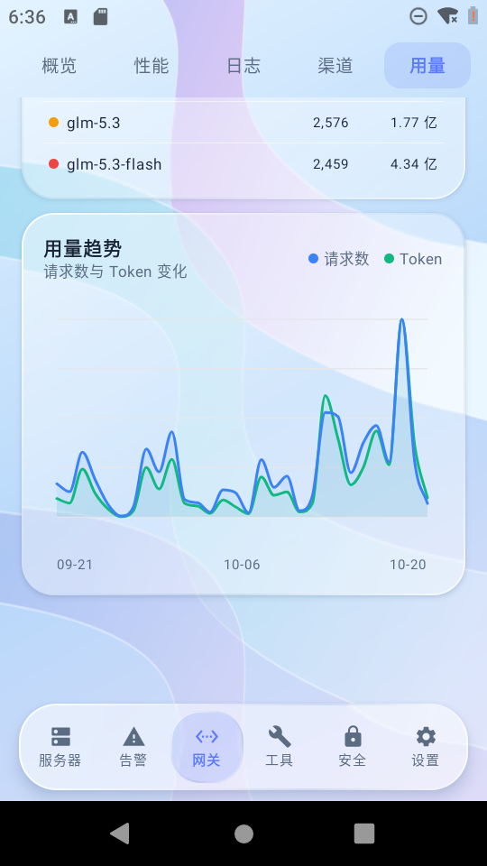
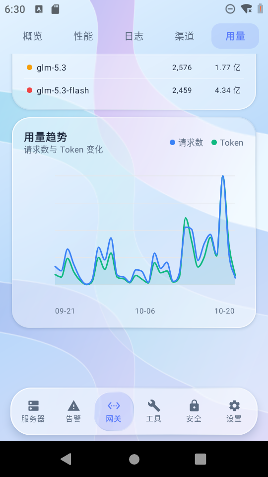
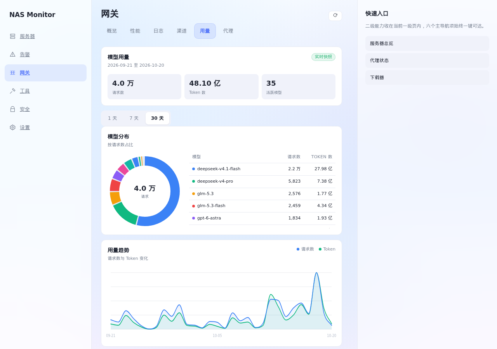
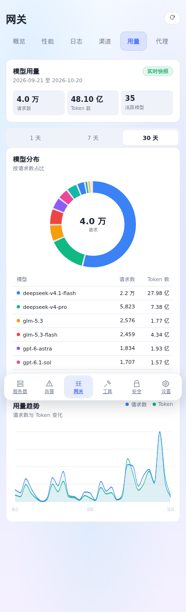
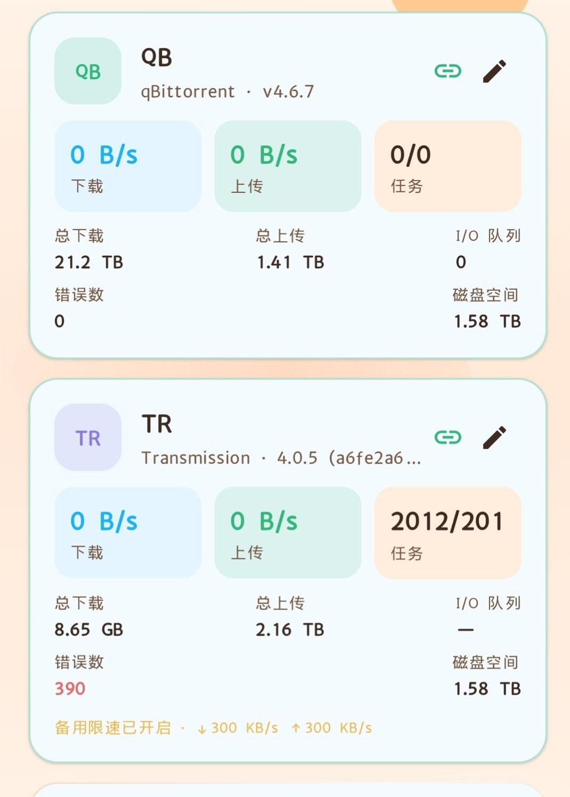
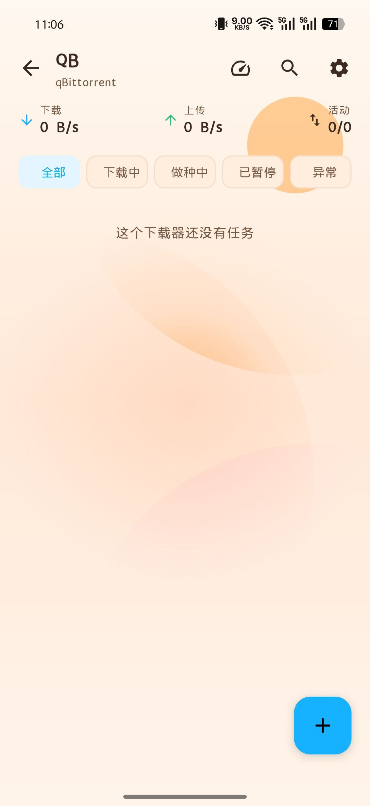
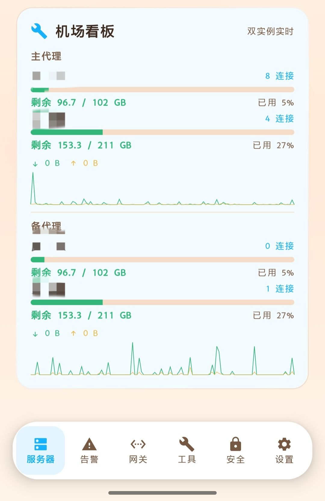
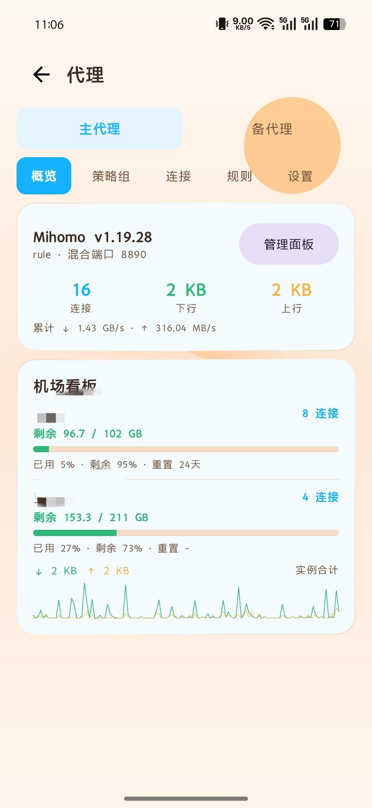
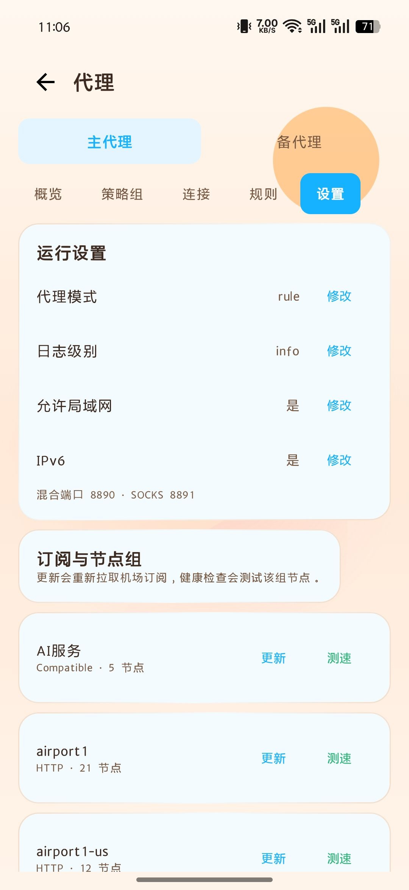

# NAS Monitor

A self-hosted dashboard for NAS and AI gateway monitoring, with an Android app and a same-origin Web interface.

[中文说明](README.md) · English

## Current Version

This documentation release is **v238.1**. The Android app remains at **238 / 238.0**; this patch only reorganizes the README and screenshot layout. It does not change business source, the APK, or screenshot assets.

Main capabilities:

- Server health, trends, disks, temperature, containers, SSH, and security status.
- New API gateway overview, logs, channels, routing policy, and model usage.
- 1-day, 7-day, and 30-day model usage: requests, tokens, ring distribution, and two-series trends.
- qBittorrent and Transmission downloaders, plus Mihomo, airport dashboard, and proxy settings.
- WorkBuddy multi-egress accounts, dynamic remote servers, and optional tools.

See [CHANGELOG.md](CHANGELOG.md) for release history (written in Chinese).

## Usage Page

The former Models tab is now Usage. It shows models that received calls, request counts, and tokens, and does not display fees, monetary amounts, quota, or dollar metrics. The backend aggregates through read-only SQLite queries and uses a 300-second snapshot with single-flight refresh and a persisted stale fallback.

| Android usage | Android trend |
| --- | --- |
|  |  |

| Web desktop | Web mobile |
| --- | --- |
|  |  |

Screenshots keep the framing and dimensions of the v238-authorized assets and only have image metadata removed. This release adds no new visual authorization.

## Screenshots

### Servers and Logs

| Servers | Gateway overview | Gateway logs |
| --- | --- | --- |
|  |  |  |

- [Log detail](docs/screenshots/04-日志详情.jpg)
- [Usage report](docs/screenshots/05-使用日报.jpg)
- [NAS detail](docs/screenshots/07-NAS详情.jpg)

### Downloaders

| Downloaders | qBittorrent tasks |
| --- | --- |
|  |  |

### Proxy and Airport

| Airport dashboard | Proxy overview | Proxy settings |
| --- | --- | --- |
|  |  |  |

### Tools

[Open the tools screenshot](docs/screenshots/06-工具.jpg)

## Quick Start

### Backend and Web

First verify Docker, ports, volume space, and the actual host and address of the Glances container or process. Deploy in a directory the user has approved:

```bash
cp backend/.env.example .env
chmod 600 .env
```

Generate a random token of at least 24 bytes locally, for example `openssl rand -hex 24`, and put it in `.env`. Never paste generated values into a chat or commit them. At minimum:

```dotenv
APP_API_TOKEN=CHANGE_ME_RANDOM_TOKEN
WEB_API_TOKEN=CHANGE_ME_ANOTHER_RANDOM_TOKEN
NAS_HOST=CHANGE_ME_HOST
NAS_GLANCES=http://<your confirmed metrics source>:<actual port>
NAS_MONITOR_SCHEDULER=0
```

```bash
docker compose -f docker-compose.example.yml config --quiet
docker compose -f docker-compose.example.yml up -d --build
docker compose -f docker-compose.example.yml exec -T nas-monitor-api python3 -c "import urllib.request; print(urllib.request.urlopen('http://127.0.0.1:8766/health').status)"
```

Open the entry point you chose and sign in with `WEB_API_TOKEN` or `APP_API_TOKEN`. Confirm the overview shows real Glances metrics. Static pages load anonymously; data endpoints require a Bearer token. The business port is 8765; the unauthenticated health probe is only on container loopback 8766.

If Glances runs in another container, `127.0.0.1` inside the monitor container refers to the monitor itself. Use the verified host LAN address or a shared Docker network service name. If no collector exists, the user decides whether to create one; never fabricate metrics.

### Android Verification

Set your own Android SDK path locally. The author's `local.properties`, signing keys, and caches are not included:

```bash
cd HADashboard
bash ./gradlew --no-daemon testDebugUnitTest
```

On first launch, configure your own backend URL and token; SSH host, username, password, and key are also configured locally. Build and sign your own production APK when needed. Without a keystore, release builds fall back to debug signing and are for development only.

## Optional Capabilities

HA, iKuai/OpenWrt, New API, WorkBuddy, the knowledge base, and upstream usage are optional. Choose them from the configuration guide. Do not install or log in to a service just because a module exists. Dynamic remote hosts can be added from the management page.

Enable container list, logs, and control only when the user has authorized it:

```bash
stat -c '%g' /var/run/docker.sock
docker compose -f docker-compose.example.yml -f docker-compose.docker.yml config --quiet
docker compose -f docker-compose.example.yml -f docker-compose.docker.yml up -d --build
```

Put the number from the first command into `DOCKER_GID` in `.env`. Docker socket access can control the host, and `:ro` does not restrict write operations on the Docker API.

## Security Boundary

- `.env` files, account directories, runtime data, logs, backups, APKs, signing keys, build caches, and production Git history must not enter public source.
- Tokens, passwords, private keys, and cookies stay in the user's own environment or credential store. Never commit, screenshot, or paste them into chat.
- The default binds to host loopback. For LAN/VPN access, set `MONITOR_BIND_ADDRESS` only after the user explicitly chooses it; keep `127.0.0.1` for a reverse proxy on the same host.
- Use TLS or a VPN for public access. Never expose Glances, the management API, or the Docker socket directly to the internet.
- Screenshots show only user-approved demo content. Every new screenshot needs a fresh review; prior approval is not a permanent exemption.

Backend verification uses an isolated environment and fake upstreams. It does not load the author's or another project's `.env`, and it does not write test data into production volumes.

## Documentation and Source

- [AI Onboarding Guide](docs/AI接手指南.md) (Chinese)
- [Configuration & Credentials](docs/配置与凭据获取说明.md) (Chinese)
- [Environment Survey Sheet](docs/环境勘察表.example.md) (Chinese)
- [Requirements](docs/需求规格.md) (Chinese)
- [Source Review Report](docs/源码交付审查报告.md) (Chinese)
- [Changelog](CHANGELOG.md) (Chinese)

`backend/api_server.py` is the backend entry point, `backend/web/` is the same-origin Web single page, and `HADashboard/` is the Android project. Pseudocode in the requirements document is not an entry point.

## License

MIT, see [LICENSE](LICENSE).
